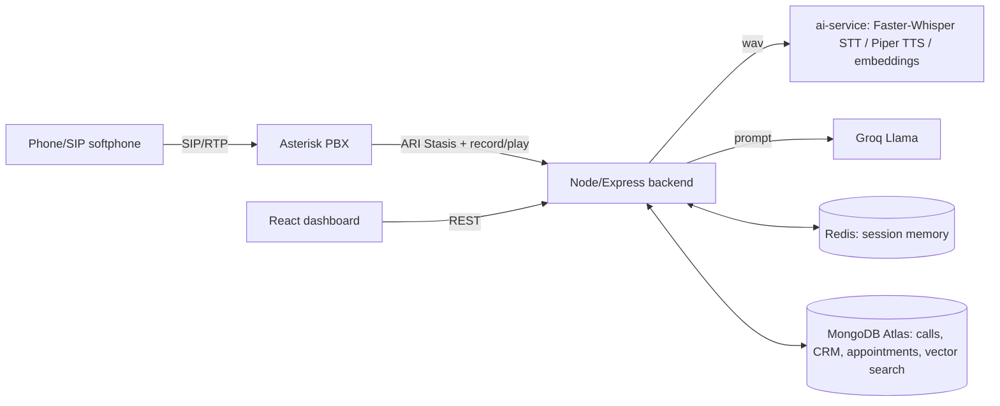

# AI Sales Voice Agent (Asterisk · Faster-Whisper · Groq/Llama · Piper · RAG)

> **Executive Evaluation Report**: See [PROJECT_REPORT.md](file:///Users/lithish/Downloads/voice-agent/PROJECT_REPORT.md) for the comprehensive 1-page technical evaluation report, system architecture diagrams, unit economics, and 100,000-user scaling blueprint.

## Business problem
Sales/support teams lose leads to missed calls, slow follow-up and inconsistent qualification. This agent answers every call 24/7, answers product questions from company knowledge (RAG), qualifies the lead, books a demo, escalates angry/complex callers to a human, and leaves a CRM-ready summary.

## Architecture

**Call flow:** answer → greet → record utterance (2s silence cut-off) → STT (+language detect) → one LLM call classifies intent/sentiment/lead fields → route: `knowledge` (Atlas Vector Search → grounded answer) · `booking` (slot check + Appointment/CRM write) · `transactional` (customer lookup) · `escalate` (dialplan → human) → LLM reply → Piper TTS (8 kHz) → play → loop. On hangup: summary, lead score, next action stored.

## Run
```bash
cp .env.example .env   # add MONGO_URI + GROQ_API_KEY
docker compose up --build
```
1. Atlas: create Vector Search index `vector_index` on `chunks.embedding` (384 dims, cosine). (Without Atlas, a cosine fallback runs automatically.)
2. Dashboard http://localhost:5173 → **Knowledge** tab: paste FAQ/pricing → Ingest.
3. **Test Call** tab: chat as a caller (same brain as phone path). Try: "What does the Pro plan cost?" → "Book a demo tomorrow at 4pm, I'm Ravi" → End call.
4. Real call: register a softphone (Zoiper/MicroSIP) to host:5060, user `softphone`/`softpass`, dial **100**.

## E2E demo workflow
Inbound call → qualifies (need/budget/timeline) → answers from KB → books demo → summary + lead score visible on dashboard.

## Scaling to 100,000 users
- Backend is stateless (session state in Redis) → horizontal scaling behind a load balancer; BullMQ/queue for post-call summarisation.
- Asterisk: a SIP load balancer (Kamailio/OpenSIPS) over a pool of Asterisk nodes (~200–300 concurrent calls per node); ARI apps per node.
- GPU pool for Faster-Whisper (batched, `large-v3`/`distil`) and Piper on CPU autoscaled; Groq handles LLM throughput. Switch from record-then-process to ARI `externalMedia` + streaming STT/TTS to cut latency (<1.5 s turn).
- Mongo Atlas sharded cluster, dedicated Search nodes; Redis cluster. 100k *registered* users ≈ 1–3k concurrent calls at peak.
- Observability: Prometheus/Grafana (latency per stage), call-quality (MOS) metrics.

## Security
TLS/SRTP for SIP/RTP, ARI bound to private network, secrets in a vault, JWT + RBAC on dashboard (add before prod), PII redaction in transcripts, encryption at rest, retention policy, call-recording consent prompt, rate limiting + fail2ban on SIP.

## Cost (rough, per 1,000 min of calls)
Groq LLM ≈ $1–3 · SIP trunk ≈ $5–15 (dominant) · self-hosted STT/TTS GPU/CPU ≈ $2–5 · infra/Atlas amortised ≈ $1–2 → **~$0.01–0.025/min** vs $0.5–1/min for a human agent. Revenue: per-minute SaaS pricing or per-booked-meeting.

## Implemented vs. architected
Implemented: STT/TTS loop, RAG, routing, memory, multilingual (STT/LLM auto; add Piper voices in `VOICES`), sentiment, lead qualification, booking, mock-CRM, summaries, dashboard.
Architected only: streaming media, real CRM (HubSpot/Salesforce webhook in `brain.js` booking branch), auth, outbound campaigns.
